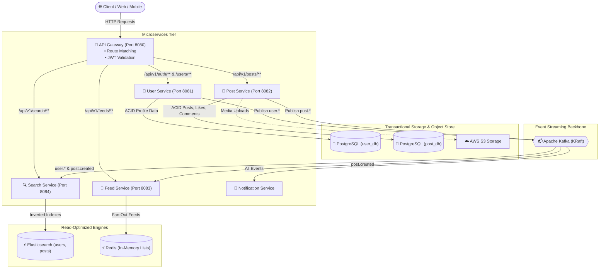
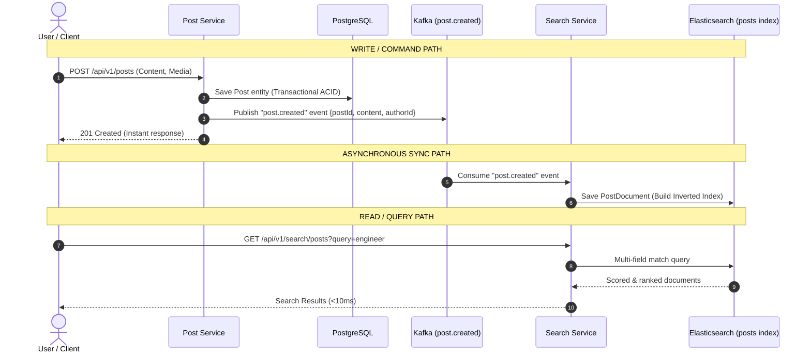
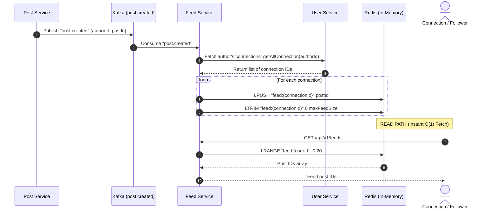

# LinkedIn System Architecture & Microservices Engine

A distributed, event-driven LinkedIn clone engineered in **Spring Boot** and **Java** that demonstrates how large-scale social networks achieve **sub-millisecond search performance**, **real-time feed generation**, and **decoupled microservices** using **CQRS**, **Apache Kafka (KRaft)**, **Elasticsearch**, **Redis**, and **PostgreSQL**.

---

## 📑 Table of Contents

- [The Core Problem: Scaling Search & Feeds](#the-core-problem-scaling-search--feeds)
- [System Architecture Overview](#system-architecture-overview)
- [How Search Works: The CQRS Pattern](#how-search-works-the-cqrs-pattern)
- [How Feeds Work: Fan-Out on Write](#how-feeds-work-fan-out-on-write)
- [Technology Stack & Deep Dive](#technology-stack--deep-dive)
- [Microservices Catalog](#microservices-catalog)
- [Kafka Event Schema](#kafka-event-schema)
- [Infrastructure & Docker Compose](#infrastructure--docker-compose)
- [Getting Started](#getting-started)
- [API Reference](#api-reference)

---

## 🎯 The Core Problem: Scaling Search & Feeds

### Why Traditional Relational Databases Fail at Scale
In a monolithic design with a relational database (e.g., PostgreSQL or MySQL):
1. **Slow Searches (`LIKE '%query%'`):** Searching across millions of users by name, headline, location, or skills causes full-table scans, heavy disk I/O, and lock contention. Relational indexes (B-Trees) cannot efficiently handle fuzzy search, typo tolerance, multi-field relevance scoring, or tokenized text.
2. **Heavy Feed Joins:** Generating a feed for a user with thousands of connections requires running recursive SQL joins across `connections`, `posts`, `users`, and `likes` tables ordered by timestamp on every page load. This collapses the database during peak traffic.
3. **Coupled Failures:** If the search or feed generation pipeline experiences high load, the primary transactional database slows down, degrading sign-ins and post creation.

### How This Project Solves It
1. **CQRS (Command Query Responsibility Segregation):** The system strictly splits **Writes (Commands)** from **Reads (Queries & Searches)**.
   - Writes go directly to **PostgreSQL** for strict ACID transactions.
   - Asynchronous events update **Elasticsearch** (for search) and **Redis** (for feeds).
2. **Event-Driven Decoupling with Kafka:** Microservices never block each other via synchronous HTTP calls for side effects. Mutations publish lightweight events to **Apache Kafka**.
3. **Inverted Indexing with Elasticsearch:** Text fields are indexed into Elasticsearch, enabling multi-token search, skill filtering, and relevance ranking in milliseconds.
4. **Precomputed Feeds in Redis:** Connections' feeds are precalculated at write time (*fan-out on write*) and stored in Redis lists, making feed retrieval an $O(1)$ memory lookup.

---

## 🏛️ System Architecture Overview



---

## 🔍 How Search Works: The CQRS Pattern

The **Search Service** does not query PostgreSQL. Instead, it reads exclusively from **Elasticsearch** documents populated asynchronously through Kafka event streams.



### Search Capabilities Implemented
* **People Search (`/api/v1/search/people`):** Executes an Elasticsearch `multi_match` query across `firstName`, `lastName`, `headLine`, and `location`.
* **Skill-based Search (`/api/v1/search/people/skills`):** Performs keyword matching against indexed user skill arrays.
* **Post Content Search (`/api/v1/search/posts`):** Analyzes and matches terms across post text.

---

## 📰 How Feeds Work: Fan-Out on Write

When an author creates a post, rather than computing who should see the post when readers open their apps, the system pushes the post ID directly into each connection's precomputed feed in **Redis**:



---

## 🛠️ Technology Stack & Deep Dive

| Component | Technology | Version | Purpose in Architecture |
| :--- | :--- | :--- | :--- |
| **Search Engine** | **Elasticsearch** | `8.11.0` | Provides distributed inverted indexes for multi-field text search, fuzzy matching, and ranking. |
| **Message Broker** | **Apache Kafka (KRaft)**| `7.4.0` | High-throughput, distributed event stream decoupling writes from search indexing and feed generation. Operates without ZooKeeper using Kafka Raft metadata mode. |
| **Relational Database** | **PostgreSQL** | `17` | Source of truth ensuring ACID consistency for user credentials, profiles, connections, and posts. |
| **Cache & In-Memory Store** | **Redis** | `7-alpine` | Ultra-fast in-memory key-value store holding user timeline feeds (`LPUSH` / `LRANGE`) and gateway rate limits. |
| **Framework** | **Spring Boot** | `4.x / 3.x` | Enterprise microservices runtime leveraging Spring Web, Spring Data JPA, Spring Data Elasticsearch, Spring Data Redis, and Spring Kafka. |
| **API Gateway** | **Spring Cloud Gateway** | — | Single entrypoint handling routing, central CORS, and JWT authentication filters. |
| **Object Storage** | **AWS S3** | SDK v2 | Cloud storage for profile photos and post media attachments. |
| **Orchestration** | **Docker & Compose** | `3.8` | Containerized local infrastructure running database, cache, broker, and search clusters with persistent volumes. |

---

## 📦 Microservices Catalog

### 1. 🚪 API Gateway (`apigateway`) — Port `8080`
- **Role:** Unified reverse proxy and edge router.
- **Security:** Intercepts incoming requests using `JwtAuthFilter`. Validates JWT tokens and injects authenticated user headers (`X-User-Id`) into downstream requests.
- **Routing Rules:**
  - `/api/v1/auth/**` $\rightarrow$ User Service (Permit All)
  - `/api/v1/users/**` $\rightarrow$ User Service (Authenticated)
  - `/api/v1/posts/**` $\rightarrow$ Post Service (Authenticated)
  - `/api/v1/feeds/**` $\rightarrow$ Feed Service (Authenticated)
  - `/api/v1/search/**` $\rightarrow$ Search Service (Authenticated)

### 2. 👤 User Service (`userservice`) — Port `8081`
- **Role:** User identity, authentication, profile management, and professional connection graph.
- **Data Store:** PostgreSQL (`user_db`).
- **Events Published:** `user.created`, `user.updated`, `connection.requested`, `connection.accepted`.

### 3. 📝 Post Service (`postservice`) — Port `8082`
- **Role:** Post authoring, media uploads, likes, and comment threads.
- **Data Store:** PostgreSQL (`post_db`) + AWS S3 (Images/Media).
- **Events Published:** `post.created`, `post.liked`, `post.commented`.

### 4. 📰 Feed Service (`feedservice`) — Port `8083`
- **Role:** Generates and serves chronological personalized user timelines.
- **Data Store:** Redis lists (`feed:{userId}`).
- **Pattern:** Fan-out on write consumed from Kafka `post.created`.

### 5. 🔍 Search Service (`searchservice`) — Port `8084`
- **Role:** Multi-criteria search engine for people, skills, and post content.
- **Data Store:** Elasticsearch indices (`users`, `posts`).
- **Pattern:** Consumer of `user.created`, `user.updated`, and `post.created`.

### 6. 🔔 Notification Service (`notificationservice`)
- **Role:** Event consumer that listens for connection requests, likes, comments, and sign-ups to dispatch user alerts.
- **Pattern:** Pure Kafka consumer.

---

## 📬 Kafka Event Schema

| Topic Name | Producer Service | Consumer Services | Payload Details |
| :--- | :--- | :--- | :--- |
| `user.created` | `userservice` | `searchservice`, `notificationservice` | User ID, name, email, headline, location, skills |
| `user.updated` | `userservice` | `searchservice` | Updated profile fields, new skills, avatar |
| `post.created` | `postservice` | `searchservice`, `feedservice` | Post ID, content, author ID, image URL, createdAt |
| `post.liked` | `postservice` | `notificationservice` | Post ID, author ID, user ID who liked |
| `post.commented` | `postservice` | `notificationservice` | Post ID, post author ID, commenter ID, comment text |
| `connection.requested`| `userservice` | `notificationservice` | Sender ID, receiver ID, status |
| `connection.accepted` | `userservice` | `notificationservice` | Sender ID, receiver ID, status |

---

## 🐳 Infrastructure & Docker Compose

The project includes a ready-to-run [docker-compose.yaml](file:///home/hariomojha/Desktop/linkedin-system/docker-compose.yaml) defining all supporting infrastructure:

| Service | Container Name | Host Port | Internal Port | Purpose |
| :--- | :--- | :--- | :--- | :--- |
| **PostgreSQL** | `postgres` | `5432` | `5432` | Primary relational database |
| **Redis** | `redis` | `6379` | `6379` | Cache & timeline store |
| **Elasticsearch** | `elasticsearch` | `9200` | `9200` | Full-text search engine |
| **Kafka (KRaft)** | `kafka` | `9092` | `29092` (Docker) / `9092` (Host) | Event streaming broker |

---

## 🚀 Getting Started

### Prerequisites
- [Docker Engine & Docker Compose](https://docs.docker.com/get-docker/)
- [Java 21+](https://adoptium.net/) (Java 25 recommended)
- [Maven 3.9+](https://maven.apache.org/)

### 1. Clone & Start Infrastructure
```bash
git clone https://github.com/your-username/linkedin-system.git
cd linkedin-system

# Start Postgres, Redis, Elasticsearch, and Kafka in the background
docker compose up -d

# Verify all containers are healthy
docker compose ps
```

### 2. Verify Services
- **Elasticsearch:** `curl http://localhost:9200`
- **Redis:** `docker exec -it redis redis-cli ping` (Returns `PONG`)
- **Postgres:** Connect using `psql -h localhost -U postgres` (Password: `root`)

### 3. Run Microservices
Open separate terminal tabs for each service (or launch through your IDE):

```bash
# Terminal 1: API Gateway
cd apigateway && ./mvnw spring-boot:run

# Terminal 2: User Service
cd userservice && ./mvnw spring-boot:run

# Terminal 3: Post Service
cd postservice && ./mvnw spring-boot:run

# Terminal 4: Feed Service
cd feedservice && ./mvnw spring-boot:run

# Terminal 5: Search Service
cd searchservice && ./mvnw spring-boot:run

# Terminal 6: Notification Service
cd notificationservice && ./mvnw spring-boot:run
```

---

## 📡 API Reference

All requests can be routed through the **API Gateway** (`http://localhost:8080`):

### 🔍 Search Endpoints
| Method | Endpoint | Description | Query Parameters |
| :--- | :--- | :--- | :--- |
| `GET` | `/api/v1/search/people` | Search users by name, headline, or location | `query=software engineer` |
| `GET` | `/api/v1/search/people/skills` | Search users by a specific skill tag | `skill=java` |
| `GET` | `/api/v1/search/posts` | Full-text search across post content | `query=microservices` |

### 👤 User & Auth Endpoints
| Method | Endpoint | Description |
| :--- | :--- | :--- |
| `POST` | `/api/v1/auth/register` | Register new account (publishes `user.created`) |
| `POST` | `/api/v1/auth/login` | Authenticate and obtain JWT token |
| `PUT` | `/api/v1/users/{id}` | Update profile details (publishes `user.updated`) |
| `POST` | `/api/v1/users/connections/{id}` | Send connection request |

### 📝 Post & Feed Endpoints
| Method | Endpoint | Description |
| :--- | :--- | :--- |
| `POST` | `/api/v1/posts` | Create post with optional image upload (publishes `post.created`) |
| `POST` | `/api/v1/posts/{id}/like` | Like a post (publishes `post.liked`) |
| `POST` | `/api/v1/posts/{id}/comment` | Comment on a post (publishes `post.commented`) |
| `GET` | `/api/v1/feeds` | Get current user's precomputed feed from Redis |
